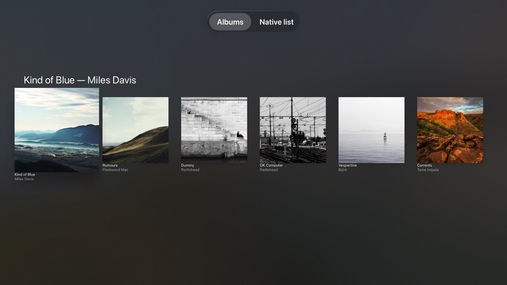
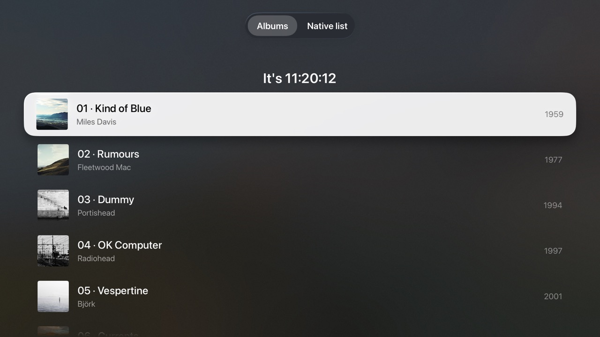

# tvml-react

A React renderer for Apple TV's [TVMLKit](https://developer.apple.com/documentation/tvmlkit).
Write tvOS screens as React components and the renderer turns them into native
TVML templates, with focus, the remote, and the system look all handled by tvOS.

```tsx
import { launch, type StartOptions } from "tvml-react";
import { useState } from "react";

function Counter() {
  const [count, setCount] = useState(0);
  return (
    <alertTemplate theme="dark">
      <title>{`Pressed ${count} times`}</title>
      <button onSelect={() => setCount((c) => c + 1)}>
        <text>Press me</text>
      </button>
    </alertTemplate>
  );
}

export function start(_options: StartOptions) {
  launch(<Counter />);
}
```

<p>
  
  
</p>

The [example app](examples/hello) running in the tvOS 26 simulator.

## What's in the box

- **Renderer.** A `react-reconciler` host config that writes straight into the TVJS DOM.
  It handles concurrent rendering, hooks, refs, and swapping templates in place.
- **Typed TVML JSX.** TVMLKit's built-in elements are lowercase tags, each with
  its own type, so `<div>` or `<lockup theme="dark">` won't compile. Styles are
  written as objects (`{ tvAlign: "center" }`). Natively registered elements are
  imported components instead.
- **Events.** `onSelect`, `onHighlight`, `onPlay`, and `onHoldSelect`, delegated
  from the document.
- **Navigation, tabs and platform hooks.** `useNavigation` for pushed screens
  and modals, and `MenuBar` for native tab bars. Hooks for app state, device, settings, storage, the media player and
  search input. Through the native bridge: appearance, accessibility, network,
  display, and keeping the screen awake.
- **JavaScriptCore polyfills.** These cover what React and everyday code expect
  but TVJS lacks: `fetch`, `AbortController`, `queueMicrotask`,
  `performance.now`, `URL` and `URLSearchParams`.
- **CLI.** `tvml-react build` and `tvml-react dev` bundle your app for TVJS using esbuild,
  serve it on your LAN, and ship a bootstrap `Application.js`.
- **Swift package.** One call to launch the app. It also fixes a TVMLKit crash
  on tvOS 26 and registers custom native elements for you. It ships a focus
  bridge for header navs, plus native elements for what TVML can't do:
  changeable backdrops, blurred cards, rounded avatars, QR codes and a
  scrolling list.

## Getting started

```sh
# Not on npm yet: install a prerelease tarball from GitHub releases
npm install https://github.com/hipstersmoothie/tvml-react/releases/download/v0.1.0-pre.2/tvml-react-0.1.0-pre.2.tgz react
npm install -D esbuild typescript @types/react
```

### 1. Point JSX at tvml-react

```jsonc
// tsconfig.json
{
  "compilerOptions": {
    "jsx": "react-jsx",
    "jsxImportSource": "tvml-react",
    "lib": ["ES2022", "DOM"], // DOM for setTimeout/XMLHttpRequest, which TVJS provides
    "moduleResolution": "bundler",
    "strict": true
  }
}
```

### 2. Export `start` from your entry

```tsx
// src/main.tsx
import { launch, type StartOptions } from "tvml-react";
import { App } from "./App";

export function start({ baseUrl }: StartOptions) {
  launch(<App apiBase={baseUrl} />);
}
```

`launch` renders into a new document and presents it. Every screen (the root,
pushed screens, modals, tabs and overlays) has its own error boundary. A screen
that throws while rendering shows an alert with the error and a Try Again
button, and the rest of the app keeps working.

### 3. Build or serve it

```sh
npx tvml-react dev src/main.tsx     # watch + serve on http://0.0.0.0:9001/, with live reload
npx tvml-react build src/main.tsx   # write dist/app.js + dist/Application.js
```

Both put two files in the output folder:

- `app.js`: your bundle.
- `Application.js`: a small bootstrap that shows a spinner, loads `app.js`, and
  calls your `start()`.

`dev` also reloads the app on the Apple TV after every successful rebuild, and
prints the app's `console.*` output in your terminal. The bootstrap turns both on
only when it finds the dev server, so production hosting is unaffected.

### 4. Load it from a tvOS app

Add the `TVMLReactExtras` Swift package (**File → Add Package Dependencies…**,
`https://github.com/hipstersmoothie/tvml-react`) and launch from your app
delegate:

```swift
import TVMLReactExtras

let window = UIWindow(frame: UIScreen.main.bounds)
self.window = window
appController = TVMLReact.launch(
  serverURL: URL(string: "http://192.168.1.42:9001/")!, // your Mac's LAN IP, or localhost in the simulator
  window: window,
  delegate: self
)
```

`TVMLReact.launch` installs tvml-react's native pieces, then points a
`TVApplicationController` at `Application.js`.

[`examples/shell`](examples/shell) is a complete Xcode project you can copy; it
runs every example in this repo.
Allow HTTP to your dev server with `NSAppTransportSecurity` → `NSAllowsLocalNetworking`.
JavaScript changes only need an app relaunch, not an Xcode rebuild.

## API

### `launch(element, options?)`

Creates a root, renders `element`, and presents the document, replacing the
current top of the navigation stack. It returns the `TVMLRoot`, or `undefined`
if the first render failed.

| Option        | Description                                                          |
| ------------- | -------------------------------------------------------------------- |
| `onError`     | Called with every error React reports. Defaults to `console.error`. |
| `errorTitle`  | Title of the default error alert.                                    |
| `renderError` | `(error, retry) => ReactNode`: what a screen shows when it throws. |
| `wrapper`     | A component wrapping the app and every pushed screen; put context providers here. |

### `createRoot(document?, options?)`

Lower-level control. If you don't pass a document, it creates an empty `<document>`.

```ts
const root = createRoot();
root.render(<App />); // flushed synchronously
presentDocument(root.document);
// later
root.unmount();
```

Your components render the document's children: one template element and an
optional `<head>`. Returning a different template element swaps the whole
screen in place (for example, `loadingTemplate` → `stackTemplate`).

The first render is flushed synchronously, which matters. TVMLKit shows an
empty document as a blank screen and ignores later mutations. Once a non-empty
document has been presented, mutations do show up, and state updates render
through React's scheduler as usual.

For more screens, use [`useNavigation`](#navigation) rather than more roots.
The lower-level helpers `getNavigationDocument`, `presentDocument`,
`parseDocument`, `createDocument` and `presentMessage` are exported too.

### Navigation

```tsx
const navigation = useNavigation();

<lockup onSelect={() => navigation.push(<AlbumDetail album={album} />)} />
```

`push`, `presentModal`, `replace`, `pop`, `popToRoot` and `dismissModal`.
`replace` swaps out the top screen. If that's the first screen, its component
unmounts, so keep app-wide timers and state above it: in `launch`'s `wrapper`,
or in the new screen. Each
pushed screen gets its own TVML document but renders from the app's one React
tree (through a portal), so state and context are shared. A screen unmounts
when TVMLKit unloads its document, including when the user presses Menu.
Providers that pushed screens need to see go in `launch`'s `wrapper` option.

### Tabs

```tsx
<menuBarTemplate>
  <MenuBar defaultSelected="home">
    <MenuBarItem id="home" title="Home"><Home /></MenuBarItem>
    <MenuBarItem id="search" title="Search"><Search /></MenuBarItem>
  </MenuBar>
</menuBarTemplate>
```

Each tab gets its own TVML document but renders from the app's one React tree,
so the tabs share context and state. A tab mounts the first time it's selected
and stays mounted, so switching back keeps its scroll position and data.
`useMenuBar().select(id)` switches tabs from code. `useIsScreenVisible()` inside a
tab follows the selected tab.

### `DocumentPortal`

Renders part of the tree into another TVML document, wired up like a screen:
events, `useScreenEvent` and `useIsScreenVisible` all work inside it. Navigation,
tabs and `PlayerOverlay` are built on it. `onReady(doc)` fires once the children
are committed, which is the earliest safe moment to present the document.

```tsx
<DocumentPortal onReady={(doc) => getNavigationDocument().presentModal(doc)}>
  <alertTemplate>…</alertTemplate>
</DocumentPortal>
```

### Events

| Prop           | TVML event   | Fires when                                                           |
| -------------- | ------------ | -------------------------------------------------------------------- |
| `onSelect`     | `select`     | A focusable element is clicked.                                      |
| `onHighlight`  | `highlight`  | Focus moves onto the element. `segmentBarItem` only fires this one.  |
| `onPlay`       | `play`       | Play/pause is pressed while the element has focus.                   |
| `onHoldSelect` | `holdselect` | A long press.                                                        |
| `onChange`     | `change`     | A value changed, e.g. a `ratingBadge` in a `ratingTemplate`.         |

Each screen adds one listener per event type to its document. When an event
fires, it walks up from the target to the nearest element that has a handler.
Handlers receive the `TVMLEvent`. As in React DOM, presses and typing are
discrete input: state updates from these handlers are committed before the
handler returns.

### Attributes and styles

- `style` takes a string or an object. Object keys are converted to kebab case
  and numbers are written without units:
  `{ tvTextMaxLines: 2, fontSize: 40 }` → `tv-text-max-lines: 2; font-size: 40;`.
- `className` becomes `class`. `true` becomes `"true"`. `false`, `null`, and
  `undefined` remove the attribute.
- An attribute is only written when its serialized value changes. This prevents
  TVMLKit from re-decoding images and replaying focus animations on every
  render.
- `ref` gives you the underlying `TVMLElement`.
- `srcset` also takes an object, `{ "1x": url, "2x": url2x }`. It warns when a
  URL contains a comma: TVMLKit splits `srcset` on commas, and the image ends up
  blank.

### Text fields and focus

`<textField>` and `<searchField>` take `onTextChange`, `defaultValue` (set once)
and `value` (controlled). Their children are the placeholder:

```tsx
<searchField value={query} onTextChange={setQuery}>Shows, people, genres</searchField>
```

A controlled field (`value`) always shows `value`. If `onTextChange` rejects a
keystroke, for example by filtering out non-digits, the field reverts to
`value`.

`focus(element)` moves focus to an element in a presented template (TVJS has no
focus API; this re-sets `autoHighlight`). It doesn't work in `formTemplate`,
where the keyboard keeps focus.

### Custom elements

Lowercase tags are reserved for TVMLKit's built-in elements. Anything custom is
an ordinary function component you import.

For an element backed by your own UIKit view, register the view in Swift and
write a component that renders the tag. `TVMLReact` takes care of
`TVElementFactory`, `TVInterfaceFactory` and sharing the single interface
creator TVMLKit allows:

```swift
// Before TVMLReact.launch
TVMLReact.register("gauge") { element, existingView in
  let view = existingView as? GaugeView ?? GaugeView()
  view.value = Double(element.attributes?["value"] ?? "") ?? 0
  return view
}
```

```tsx
import { createElement } from "react";
import type { TVMLAttributes } from "tvml-react";

export function Gauge(props: TVMLAttributes & { value: number }) {
  return createElement("gauge", props);
}

<Gauge value={0.4} style={{ width: 400, height: 40 }} />
```

Props become attributes on the element, and the shared props (`style`,
`onSelect`, `ref`, ...) work as they do on built-in tags.

## Hooks

Hooks for what the Apple TV itself knows. The first group uses APIs TVJS
already provides. The second group reads from a small native bridge that
`TVMLReact.launch` installs, so it needs no Swift from you. Without the bridge
those hooks return defaults.

| Hook | Returns |
| --- | --- |
| `useNavigation()` | `push`, `presentModal`, `replace`, `pop`, `popToRoot`, `dismissModal` |
| `useScreenEvent(type, fn)` | Runs `fn` on this screen's `load`, `appear`, `disappear` or `unload` |
| `useIsScreenVisible()` | Whether this screen is the one on the TV |
| `useAppState()` / `useAppEvent("suspend" \| "resume", fn)` | `"active"` or `"background"`, from `App.onSuspend`/`onResume` |
| `useDevice()` | Model, product type, tvOS version, app id and version, vendor id |
| `usePlatformSettings()` | Language, storefront country and parental restrictions |
| `useTraitCollection()` | Screen size, scale and layout direction |
| `useLocalStorage(key, initial)` | JSON state in TVJS `localStorage`, synced between components |
| `usePlayer()` | See [Media playback](#media-playback) |
| `onTextChange` on `<searchField>`/`<textField>` | The typed text, as the user types |
| **Native bridge** | |
| `useColorScheme()` | `"light"` or `"dark"` |
| `useAccessibility()` | Reduce Motion, VoiceOver, Bold Text, Reduce Transparency, Closed Captions, Increase Contrast |
| `useNetworkStatus()` | `online`, `expensive`, `constrained`. Without the bridge it polls `Device.isNetworkReachable` |
| `useDisplay()` | Size, scale, max refresh rate, HDR support |
| `useKeepAwake(enabled?)` | Stops the screensaver while mounted |

Also exported: `openURL` and `canOpenURL` (to open other apps), `reloadApp()`,
and `getKeyboard(element)` for setting a field's text yourself.

```tsx
function Search() {
  const [query, setQuery] = useState("");
  return (
    <searchTemplate>
      <searchField onTextChange={setQuery} />
      <collectionList>{/* results for query */}</collectionList>
    </searchTemplate>
  );
}

function NowPlaying() {
  useKeepAwake();
  const { reduceMotion } = useAccessibility();
  const player = usePlayer();
  return (
    <buttonLockup onSelect={() => player.play({ url: STREAM, title: "Live" })}>
      <title>{player.state === "playing" ? "Playing" : "Play"}</title>
    </buttonLockup>
  );
}
```

## Media playback

For anything beyond a single screen, put one `PlayerProvider` in `launch`'s
`wrapper` so the whole app shares a player:

```tsx
launch(<App />, { wrapper: [QueryProvider, PlayerProvider] });

// Any screen can start playback…
const { play, pause, stop } = usePlayerControls();     // stable, never re-renders
<lockup onSelect={() => play({ url, title, artworkImageURL, startTime: saved })} />

// …and any can show what's playing. Selectors re-render only when their value changes.
const title = usePlayerState((s) => s.currentItem?.title);
const playing = usePlayerState((s) => s.state === "playing");

// Save where the user stopped, whatever the reason.
usePlayerEvent("itemEnd", ({ item, time, duration, reason }) => save(item, time));

// Draw over the video: artwork for audio, live chat, a now-playing card.
<PlayerOverlay>
  <divTemplate>…</divTemplate>
</PlayerOverlay>
```

- **State.** `usePlayerState()` gives `state`, `currentTime`, `duration`,
  `currentItem`, `error`, `isLive` (playing with no known duration) and
  `endReason`. Pass a selector that returns a primitive or a stable value, so
  the caller doesn't re-render once a second during playback.
- **`itemEnd` reasons.** `"playedToEnd"`, `"stopped"`, `"userInitiated"` (Menu),
  `"error"`, `"forwardedToEnd"`, `"playlistChanged"`. The event carries the last
  real position and is reported once per item. `PlayerProvider` also takes an
  `onItemEnd` prop.
- **Start position.** `startTime` starts playback at a position. `resumeTime`
  instead makes TVMLKit ask "Resume Playback / Start from Beginning" and wait.
- **`<PlayerOverlay>`** uses the shared player, and can be mounted before or
  during playback. With `interactive`, it takes focus when the user swipes
  down.
- **`usePlayer()`.** Inside a provider it's the shared player, with state and
  actions in one object, re-rendering as playback progresses. Without a
  provider, each call owns a player that stops when the component unmounts.
  That's fine for a single screen; pass the result to `<PlayerOverlay player>`.
- **Escape hatch.** `nativePlayer()` returns the TVJS `Player` itself.
- **Covered screens.** Presenting the player fires `disappear` on the screen
  underneath, so screen queries pause while the video is up. Pass
  `refreshWhileHidden` for data drawn in an overlay.

## Data fetching

Use [TanStack Query](https://tanstack.com/query) through `tvml-react/query`:

```sh
npm install @tanstack/react-query
```

```tsx
import { QueryClient } from "@tanstack/react-query";
import { TVMLQueryProvider, useScreenQuery } from "tvml-react/query";

const client = new QueryClient();

launch(<App />, {
  wrapper: ({ children }) => <TVMLQueryProvider client={client}>{children}</TVMLQueryProvider>,
});

function LiveNow() {
  const { data, status } = useScreenQuery({
    queryKey: ["live"],
    queryFn: ({ signal }) => fetch(LIVE_URL, { signal }).then((r) => r.json()),
    refetchInterval: 30_000,
  });
  // …
}
```

`TVMLQueryProvider` puts TanStack Query in the right mode for the TV:
- **Not a server.** TVJS has no `window`, so TanStack Query would otherwise
  assume it's running on a server and silently turn off `refetchInterval` and
  retries.
- **Focus is app resume.** `refetchOnWindowFocus` refetches stale data when the
  user comes back to the app.
- **Online is the Apple TV's connection.** Queries pause offline and refetch on
  reconnect.

`useScreenQuery` and `useScreenInfiniteQuery` are `useQuery` and
`useInfiniteQuery` that pause while their screen is hidden. A hidden tab or a
covered screen stops polling and skips focus and reconnect refetches, but its
data stays cached and in-flight requests aren't cancelled. When the screen
reappears, stale data refetches. Pass `refreshWhileHidden: true`, or use plain
`useQuery`, for data that should keep refreshing while hidden, such as a live
chat overlay drawn over the fullscreen player. The player covers the screen
that opened it, so overlay data needs this.

Put the provider in `launch`'s `wrapper` so tabs and pushed screens share one
cache. `wrapper` also takes a list, outermost first:
`wrapper: [QueryProvider, PlayerProvider]`. Everything else is plain TanStack
Query.

TV tips:
- **Paging grids.** Load the next page from `onHighlight` near the end of a
  grid with `fetchNextPage({ cancelRefetch: false })`. The default restarts the
  in-flight request on every focus move.
- **Set a `staleTime`.** App resume counts as window focus, so with the default
  `staleTime: 0` every visible query refetches each time the user comes back.
- **Polling restarts on remount.** `refetchInterval` timers belong to the
  query's subscriber, so they start again whenever a screen is replaced or
  remounted. For a steady cadence, also set `staleTime`, so a remount refetches
  only when data is actually old.
- **Offline queries pause.** They don't fail: `status` stays `"pending"` with
  `fetchStatus: "paused"`. Show a "waiting for a connection" state rather than
  a spinner that never ends.
- **Persisting the cache.** TVJS's `localStorage` is synchronous, so TanStack's
  `@tanstack/query-sync-storage-persister` with
  `@tanstack/react-query-persist-client` can save the cache for instant, offline
  launches. Pass `storage: localStorage` explicitly: its default looks for
  `window.localStorage`, which TVJS doesn't have.

`fetch` comes from tvml-react's polyfills. TVJS has `XMLHttpRequest` but no
`fetch`, so `fetch`, `Headers`, `Response`, `AbortController` and `AbortSignal`
are built on top of it. They cover JSON and text bodies (no streaming or blobs).
TVJS's `XMLHttpRequest` fires `error` instead of `load` for HTTP errors such as
404; the polyfill resolves those as ordinary responses with `ok: false`. For
timeouts, use `AbortSignal.timeout(ms)`, combined with other signals via
`AbortSignal.any([...])`, or pass the non-standard `timeout` option.

## WebSockets

TVJS has no `WebSocket`. When the app is started with `TVMLReact.launch`, the
polyfills install a standard one backed by the native bridge's
`URLSessionWebSocketTask`, so WebSocket libraries work unchanged:

```ts
const ws = new WebSocket(
  "wss://jetstream2.us-east.bsky.network/subscribe?wantedCollections=app.bsky.feed.post",
);
ws.onmessage = (event) => handle(JSON.parse(event.data as string));
```

It covers text and binary messages, subprotocols, `close(code, reason)`, and
the `on*` handlers as well as `addEventListener`. Differences from the browser:
- Binary messages arrive as `ArrayBuffer`. TVJS has no `Blob`, so `binaryType`
  is always `"arraybuffer"`.
- `bufferedAmount` is always 0.

Sockets can be dropped while the app is in the background, so reconnect on
`useAppEvent("resume")` if you need to. There's still no `EventSource`.

## Testing on the device

TVJS supports synthetic events, so you can drive a running app from JavaScript
without XCUITest. `tvml-react/testing` has the helpers:

```ts
import { fireSelect, queryAll, queryByText, typeText } from "tvml-react/testing";

fireSelect(queryByText("Kind of Blue")!);        // bubbles up to the lockup's onSelect
typeText(queryAll("searchField")[0], "miles");   // sets the text and fires onTextChange
```

- **Where they search.** Queries search every visible screen (including the
  selected tab) unless you pass a root.
- **Disabled elements.** Firing an event at a disabled element throws, since
  a real remote can't reach it.
- **State is up to date.** Handlers run synchronously, so the next query sees
  the new state.

## Swift package

`TVMLReactExtras` (sources in `native/`) is the native half of tvml-react.

- **`TVMLReact.launch(serverURL:window:delegate:)`** installs everything below
  and starts the app.
- **`TVMLReact.install()`** does the installing without launching, if you'd
  rather create the `TVApplicationController` yourself.
- **`TVMLReact.register(_:childElements:makeView:)`** registers custom elements
  (see [Custom elements](#custom-elements)).

`install()` also works around a TVMLKit bug. In apps built with the tvOS 26 SDK,
TVMLKit's own `<shelf>`, `<grid>`, `<row>` and other collection elements crash
with *"Accessing the focus system through UIScreen is no longer supported"*. The
workaround answers that lookup through `UIFocusSystem` instead.

### `FocusBridgeWindow`

TVML focus is purely geometric, and TVJS has no API for moving it. As a result,
a control with nothing directly above it can't get back up to a header
`segmentBar`. Use `FocusBridgeWindow(frame:headerHeight:)` as the controller's
window. It adds a `UIFocusGuide` that connects the header and the body in both
directions.

### Native elements

`TVMLReact.install()` registers native view elements for the things TVML can't
do; import them as components from `tvml-react/native`. Each is a leaf that
draws itself. TVMLKit places it using its `style` width, height and
`tvPosition`, but it can't contain TVML children.

```tsx
import { Avatar, Backdrop, Card, QRCode, SimplifiedList, SimplifiedListRow } from "tvml-react/native";
```

| Component | What it's for |
| --- | --- |
| `Backdrop` | A full-bleed background image that, unlike `<background>`, can change after the screen is shown. Cross-fades between images (`crossfade` seconds) and can darken them (`dim`, 0–1). Draws behind the whole template, header included, and takes no layout space. |
| `Card` | A blurred, rounded panel with `title`, `subtitle`, `body` and an `image`. `material` is `"dark"`, `"light"` or `"regular"`. TVML has no blur or rounded panels. |
| `Avatar` | A rounded (by default circular) image, showing the `name`'s initials while it loads or when there's no `src`. TVML ignores `border-radius` on images. |
| `QRCode` | A QR code for `value`, drawn natively: offline and sharp at 4K. `foreground` and `background` take hex colors. |
| `SimplifiedList` / `SimplifiedListRow` | A natively scrolling list for `divTemplate`, which doesn't scroll. Rows take `title`, `subtitle`, `accessory` and `image`, and report presses and focus through `onSelect` and `onHighlight`. A `segmentBar` header above it stays standard TVML. |

```tsx
<divTemplate>
  <Backdrop src={artworkURL} dim={0.5} />
  <Card style={{ tvPosition: "center", width: 900, height: 280 }} title={album} subtitle={artist} image={coverURL} />
  <QRCode style={{ tvPosition: "bottom-right", width: 220, height: 220 }} value="https://example.com/link" />
</divTemplate>
```

`measureText(text, { fontSize, fontWeight })` (from `tvml-react`) returns
`{ width, height }` in points, measured natively, so you can size a cell to
its text. TVML has no intrinsic sizing.

## Build tooling without the CLI

`tvml-react/build` exports the esbuild preset, so you can add to it yourself:

```js
import { build, serve, tvmlBuildOptions } from "tvml-react/build";

await build({ entry: "src/main.tsx", outdir: "public/tv" });
// or: esbuild.build(tvmlBuildOptions({ entry, outdir, esbuild: { /* overrides */ } }))
```

With a different bundler, you need to:

- Emit one classic script, not ESM.
- Target roughly Safari 15.
- Import `tvml-react/polyfills` before anything else.
- Publish your exports as `globalThis.TVMLReactApp`, or write your own
  `Application.js`.

## Notes

- **Debugging.** `tvml-react dev` prints the app's console output in your
  terminal. For a full Web Inspector on the TVJS context, open Safari →
  Develop → *your Apple TV or simulator*.
- **Template quirks.** [docs/platform-notes.md](docs/platform-notes.md)
  collects what we've learned about TVMLKit on tvOS 26: which styles work in
  `divTemplate`, elements that don't update after presentation, `srcset` and
  comma URLs, `formTemplate` limits, and more.
- **TVMLKit's future.** Apple hasn't put much into TVMLKit for years. This
  renderer works with it as it is and works around what it has to.

## Development

```sh
pnpm install
pnpm test        # vitest, against an in-memory fake TVJS DOM
pnpm typecheck   # includes compile-time checks for the JSX types
pnpm build

cd examples/hello && pnpm dev   # serves on :9100; run examples/shell in Xcode
```

Remote-driven UI tests run the hello example in a tvOS simulator, pressing
the Siri Remote's buttons through Xcode's UI testing. They cover real select
presses, Menu, focus moving across the tab bar, native list rows and typing on
the system keyboard:

```sh
examples/shell/ui-tests.sh   # starts the hello dev server if needed
```

The shell's Xcode project is generated from `examples/shell/project.yml`
with [XcodeGen](https://github.com/yonaskolb/XcodeGen).

## License

MIT
