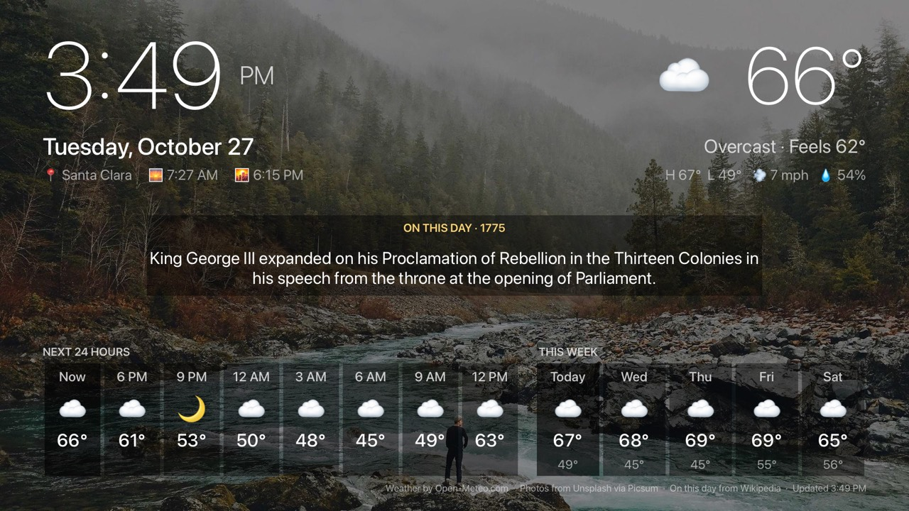

# Dashboard

An always-on, glanceable living-room screen for Apple TV, built with tvml-react
in a single `divTemplate`:

- a big clock and date, formatted for the TV's language with `Intl`
  (`usePlatformSettings`);
- current conditions, the next 24 hours and the week from
  [Open-Meteo](https://open-meteo.com) (no API key). Units follow the App Store
  storefront (°F/mph in the US, °C/km/h elsewhere), and the location comes from
  IP geolocation, falling back to the storefront country's capital;
- sunrise and sunset, plus a rotating "On this day" item from Wikipedia;
- a photo backdrop that changes every 5 minutes, dimmed (dark mode) or frosted
  (light mode) so text stays legible.

It's also a stress test for custom layout in TVML. See `src/layout.tsx` for
what works in a `divTemplate` and the small set of primitives (`Row`, `Cell`,
`Spacer`, `Columns`) the screen is built from.



## Platform behaviour

| Hook | Used for |
| --- | --- |
| `useKeepAwake()` | No screensaver while the dashboard is up |
| `useAppState()` | "On this day" and backdrop rotation stop while the app is in the background |
| `useAppEvent("resume")` | Resyncs the clock |
| `useNetworkStatus()` | Shows an "Offline · as of 3:34 PM" badge |
| `useAccessibility().reduceMotion` | Keeps one backdrop instead of rotating |
| `useColorScheme()` | Light or dark palette, template theme and backdrop treatment |
| `useNavigation().replace()` | Swaps the backdrop. TVMLKit never re-reads a `<background>` once the document is up, so each new photo gets a new document |

## Data

Location, weather and "On this day" are [TanStack Query](https://tanstack.com/query)
queries, through `tvml-react/query`:

- `TVMLQueryProvider` sits in `launch`'s `wrapper` (`src/main.tsx`), so the
  screens that `navigation.replace()` presents for each new backdrop share one
  cache and render without refetching.
- Each query is a `useScreenQuery` with its own `staleTime` and
  `refetchInterval` (weather: stale after 10 minutes, polled every 15; "On
  this day": 6 hours; location: a day). tvml-react/query maps TanStack's
  "window focus" to the app being in the foreground and "online" to the
  Apple TV's connectivity, so polling stops in the background, stale data is
  refetched on resume, and fetching pauses offline and resumes on reconnect.
- The forecast is a dependent query: it waits for the location (IP
  geolocation, or the storefront capital if that fails) via `skipToken`.
- `src/lib/persist.ts` saves each query's last good result to `localStorage`
  and restores it as `initialData` (with `initialDataUpdatedAt`), so the
  dashboard launches instantly, and offline, with the last forecast.
  `staleTime` then decides whether it's refetched.

## Run it

```sh
pnpm dev   # serves on http://localhost:9106/
```

Then launch the examples shell app against it:

```sh
xcrun simctl launch <udid> dev.tvml-react.examples -TVMLServerURL http://localhost:9106/
```

`pnpm typecheck` and `pnpm build` check and bundle it.

## Network services

- `api.open-meteo.com`: forecast (CC BY 4.0, credited on screen)
- `get.geojs.io`: IP geolocation
- `api.wikimedia.org`: "On this day"
- `picsum.photos` through `images.weserv.nl`: backdrop photos, dimmed by the proxy

TVJS has no `fetch`; tvml-react polyfills it (and `AbortController`, so
TanStack Query's `signal` cancels requests).
