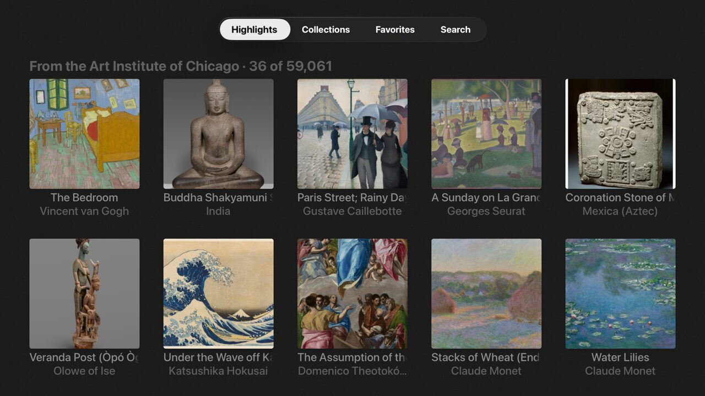

# gallery

An art browser for the [Art Institute of Chicago](https://api.artic.edu/docs/)'s
public-domain collection. The API needs no key.



- **Menu bar.** A `menuBarTemplate` with four tabs, built with tvml-react's
  `MenuBar` and `MenuBarItem` (see [`App.tsx`](src/App.tsx)). Each tab mounts
  the first time it's selected and stays mounted.
- **Highlights.** An endless `<grid>` in a `stackTemplate`. The next page loads
  when focus gets within 15 cells of the end. Cells are memoized, so appending
  a page only creates the new lockups.
- **Collections.** A `catalogTemplate` of museum departments. A department's
  preview grid loads the first time it's highlighted.
- **Artwork.** A `productTemplate` with the artwork's details. Select the
  description to read all of it. From here you can open the full-screen
  viewer, favorite the artwork, start a slideshow, or see more by the artist.
- **Viewer.** A `oneupTemplate` to swipe through the list you came from,
  starting at the artwork you picked (`autoHighlight`).
- **Ambient.** A screensaver-style slideshow built in React on a `divTemplate`.
  It uses `useKeepAwake` and pauses with `useIsScreenVisible`.
- **Slideshow.** TVJS's undocumented `Slideshow` global (the system photo
  slideshow). Its signature was reverse-engineered; see
  [`src/slideshow.ts`](src/slideshow.ts). In the tvOS 26.5 simulator it shows
  a blank screen and never fetches the images. Try it on hardware.
- **Favorites.** Press and hold any artwork, or choose Favorite on its page.
  Favorites are saved with `useLocalStorage` and stay in sync across every tab.
- **Search.** A `searchTemplate` that searches the full collection as you
  type, with a debounce.
- **Image sizing.** Every image has a `srcset={{ "1x": …, "2x": … }}` with
  candidates from the museum's IIIF server. TVMLKit picks `2x` on a 4K Apple
  TV. Sizes are given as IIIF `pct:` values, because TVMLKit's `srcset` parser
  splits on commas and the usual `!w,h` sizes contain one.
- **Requests.** [`api.ts`](src/api.ts) uses the `fetch` and `AbortController`
  that tvml-react provides in TVJS. Leaving a screen or changing a search
  aborts its request.

```sh
pnpm install && pnpm build   # from the repo root
cd examples/gallery
pnpm dev                     # serves http://0.0.0.0:9105/
xcrun simctl launch booted dev.tvml-react.examples -TVMLServerURL http://localhost:9105/
```

The tvOS app is the shared [shell](../shell).
