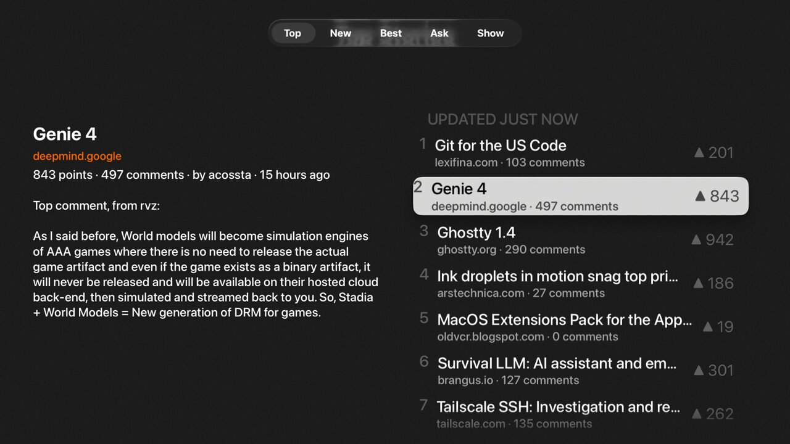

# Hacker News

A Hacker News reader for Apple TV, built with tvml-react.



## What it shows

- **Tabs with `menuBarTemplate`.** Top, New, Best, Ask and Show live in the
  system tab bar, built with `<MenuBar>` and `<MenuBarItem>` (`src/App.tsx`).
  Each tab mounts the first time it's selected and stays mounted, so switching
  back keeps its stories and scroll position.
- **Data fetching with TanStack Query** (`tvml-react/query`). `src/main.tsx`
  puts `TVMLQueryProvider` in `launch`'s `wrapper`, so the tabs and every pushed
  screen share one `QueryClient`. That provider also tells TanStack Query that
  TVJS isn't a server, that the app coming back from the background counts as
  "window focus", and when the Apple TV is online. The query options live in
  `src/queries.ts`. Queries pause while their screen isn't on the TV
  (`useScreenQuery`, `useScreenInfiniteQuery`): hidden tabs and covered screens
  don't refetch but keep their data. When they appear again, or the app
  resumes, they refetch any data that's gone stale.
  tvml-react polyfills `fetch` and `AbortController` on top of TVJS's
  `XMLHttpRequest`. `src/lib/http.ts` adds a timeout, typed JSON and error
  messages worth showing on screen.
- **Story lists** in a `listTemplate`: rank, title, site and score in each
  `listItemLockup`, with a large `relatedContent` preview of the highlighted
  story: points, comments, author, relative age via `Intl.RelativeTimeFormat`,
  and the text of Ask HN posts. When focus rests on a story for a moment, its
  comments load and the preview shows the top one; the story screen uses the
  same query, so opening it is instant. Each feed is a `useInfiniteQuery` that
  loads 30 stories at a time from the Firebase API (10 requests at once), and
  `fetchNextPage` runs when focus gets within five rows of the end. The first
  page fetches the feed's ids and later pages carry them along, so Refresh
  reloads every page that's on screen from the same list.
- **Story detail** with the comment tree from one Algolia request, one level
  at a time: the story lists its top-level comments, and selecting a comment
  opens its replies, and so on down (`src/Comments.tsx`). The highlighted
  comment's full text fills the preview. Play, or selecting a comment with no
  replies, opens it in a `descriptiveAlertTemplate`, which scrolls long text.
  Links show as a QR code you can scan with your phone, since tvOS has no web
  browser.
- **HTML to text** (`src/text.ts`). TVML text elements can't render HTML, so
  `<p>` becomes a blank line, links become their full URL, and entities are
  decoded.
- **Loading, error and retry.** Screens swap between `loadingTemplate`,
  `alertTemplate` (with a Try Again button) and the list. Failed requests are
  retried once, unless the server answered with a 4xx. If a background refresh
  fails, TanStack Query keeps the old data (`isRefetchError`), so it stays on
  screen and the header says the refresh failed. A failed page load shows on the
  Load More row (`isFetchNextPageError`) instead.

## Run it

```sh
pnpm dev   # builds, watches and serves on http://localhost:9104/
```

Then launch the examples shell app pointed at it:

```sh
xcrun simctl launch <udid> dev.tvml-react.examples -TVMLServerURL http://localhost:9104/
```

The app reloads itself after every successful rebuild, and its `console` output
shows up in the terminal running `pnpm dev`.
