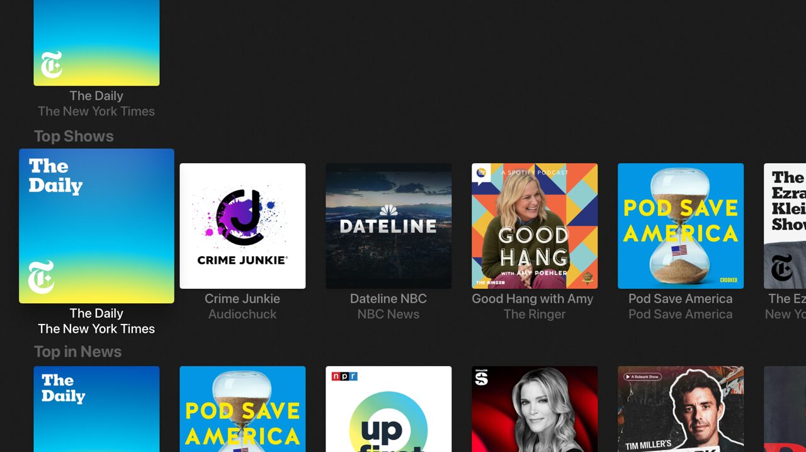

# podcasts

A podcast player for Apple TV built with tvml-react: browse Apple's charts,
search the iTunes directory, read show feeds, subscribe, and listen with resume.



## What it shows

- **Tabs** (`menuBarTemplate`): *Listen Now* and *Search*.
- **Listen Now** (`stackTemplate`): *Continue Listening* (lockups with a
  `progressBar` overlay), *Your Shows*, then Apple Podcasts top charts overall
  and by genre. Each shelf loads on its own.
- **Search** (`searchTemplate`): `<searchField onTextChange>` with a 400 ms
  debounced query key. The previous results stay up while the next ones load
  (`placeholderData: keepPreviousData`), a request for a term nobody's waiting
  for is cancelled, and there are loading, empty and error states.
- **Show detail** (`listTemplate`): a Resume / Play Latest row, a Subscribe
  toggle, and episode rows (`listItemLockup` with `subtitle`, `decorationLabel`
  and per-row `relatedContent` show notes). The whole feed is cached; `select`
  picks the rows on screen, 40 more at a time.
- **Episode actions**: long press (`onHoldSelect`) opens a modal with
  *Play from Beginning*, *Mark as Played/Unplayed* and *Go to Show*.
- **Playback**: tvml-react's `PlayerProvider` in `launch`'s `wrapper`, so
  every screen shares one player. `PodcastPlayer` (`src/PlayerProvider.tsx`)
  adds `playEpisode` on top: it resumes where you left off (`startTime`) and
  saves progress with `usePlayerState` selectors (every 15 s and on pause, so
  it doesn't re-render every second) and `usePlayerEvent("itemEnd")`. Audio
  items get an artwork overlay rendered with `<PlayerOverlay>`. Pressing
  play/pause on a focused episode (`onPlay`) starts it.
- **Persistence** with `useLocalStorage`: subscriptions, plus each episode's
  position and played state. The position is saved every 15 s of playback and
  on pause or stop.
- **Data** with [TanStack Query](https://tanstack.com/query) through
  `tvml-react/query`: `TVMLQueryProvider` sits in `launch`'s `wrapper` (with the
  player), so every screen shares one cache and going back is instant. Screens
  read it with `useScreenQuery`, which pauses while a screen is covered and
  refetches stale data when it reappears; returning to the app counts as
  window focus. Keys, fetchers and freshness live in `src/queries.ts`: charts
  stay fresh for an hour, searches for 10 minutes, feeds for 15. Chart entries
  have no feed URL, so the feed query looks the show up first
  (`ensureQueryData`).
- **Requests**: iTunes Search/Lookup and the `toppodcasts` RSS-JSON charts over
  `fetch`, with TanStack Query's `signal` for cancellation plus a 20 s timeout
  (`AbortSignal.any`/`timeout`). Network errors, timeouts and 5xx are retried
  twice; a 404 or a broken feed fails right away. Show feeds are parsed with
  `parseDocument` (TVJS's own `DOMParser`). Dates use
  `Intl.DateTimeFormat`/`RelativeTimeFormat`.

## Run it

```sh
pnpm dev   # builds, watches, and serves on http://localhost:9102/
```

Then launch the [shell app](../shell) pointed at it:

```sh
xcrun simctl launch booted dev.tvml-react.examples -TVMLServerURL http://localhost:9102/
```

The app reloads on every rebuild and its `console` output shows up in the
terminal; you don't need to rebuild in Xcode.

## Notes

- **RSS in TVJS.** `DOMParser` (and `XMLHttpRequest.responseXML`) parse real
  feeds quickly: a 3.3 MB, 735-episode feed parses in about 50 ms. There are
  some gaps, though. `getElementsByTagName("itunes:duration")` matches nothing,
  and there's no `getElementsByTagNameNS`, so `src/rss.ts` walks child nodes
  and compares `nodeName` instead. Malformed XML throws an `IKDOMException`.
- **Resuming.** `startTime` starts where you left off without TVMLKit's
  *Resume Playback / Start from Beginning* prompt (which `resumeTime` shows).
- **Audio artwork.** On their own, audio items play over a black screen, so
  `PodcastPlayer` renders the artwork with `<PlayerOverlay>`.
