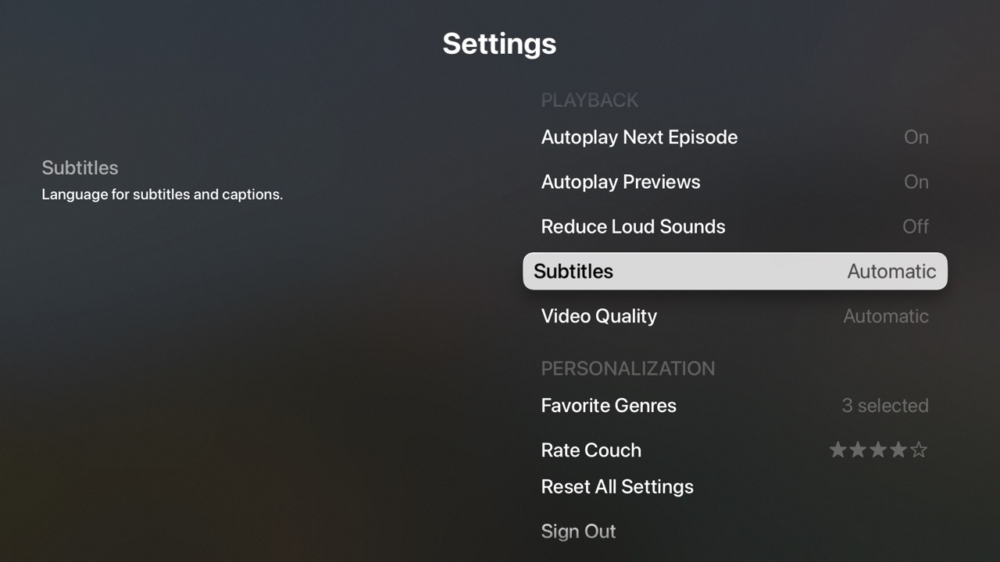

# settings: forms, settings and onboarding



An "account & preferences" app for a made-up streaming service, Couch. It shows
how to build input-heavy tvOS screens with tvml-react:

- **Onboarding.** A stack of pushed screens: Welcome → name → email → parental
  PIN → favorite genres → done. Each text step is a `formTemplate` with live
  validation shown in the banner. When onboarding finishes, the root screen
  swaps from `alertTemplate` to the settings `listTemplate` in place.
- **Text input.** `<textField onTextChange>` with `keyboardType="emailAddress"`,
  and `keyboardType="numberPad"` plus `secure` for the PIN. A small
  `TextInput` component adds a `placeholder` (TVML takes it from the field's
  text content) and a `defaultValue` (written to the field's Keyboard
  feature), so the edit screens open with the current value filled in.
- **Settings without switches.** TVML has no toggle, so toggles are
  `listItemLockup`s whose `decorationLabel` shows On/Off. Single-choice lists
  (Subtitles, Video Quality) mark the current option with a checkmark
  `decorationImage` and use `autoHighlight` so it starts focused. Genres are a
  multi-select list of checkmark rows. A `relatedContent` panel describes
  whichever row has focus.
- **Rating.** `ratingTemplate` with an interactive `ratingBadge`. Its `change`
  event isn't delegated by tvml-react, so the screen listens for it through a
  ref.
- **Confirmations.** "Reset all settings?", "Sign out?" and "Turn off PIN?"
  are `alertTemplate`s shown with `navigation.presentModal`. Cancel has focus
  by default.
- **Persistence.** The profile and preferences are stored with
  `useLocalStorage`. If you quit in the middle of onboarding, you pick up
  where you left off with your answers filled in.

```
src/
  main.tsx, App.tsx       launch; root switches Welcome ↔ Settings
  store.ts                useProfile / usePreferences (useLocalStorage), option lists
  validation.ts           name / email / PIN validators
  components/TextInput    textField with placeholder + defaultValue
  components/FormScreen   one formTemplate step with validation feedback
  components/Rows         ToggleRow, ValueRow, CheckRow (listItemLockup patterns)
  screens/                Onboarding, Settings, OptionPicker, GenrePicker, RateApp, ConfirmAlert
```

## Run it

```sh
pnpm dev   # builds, watches and serves on http://localhost:9107/
```

Then launch the shared example shell (`examples/shell`) in the tvOS
simulator, pointed at this server:

```sh
xcrun simctl launch <udid> dev.tvml-react.examples -TVMLServerURL http://localhost:9107/
```

After a JavaScript change, relaunch the app. You don't need to rebuild in
Xcode. To see onboarding again, choose **Sign Out** in Settings.

## TVML notes learned here

- A `formTemplate` only shows its **first** `textField`, so a form with
  several fields has to be a sequence of screens.
- The text inside `<textField>` is its placeholder. The typed text lives on
  `getKeyboard(el).text`. Setting it fills the field but doesn't fire
  `onTextChange`.
- On a presented `listTemplate`, calling `setAttribute("autoHighlight", "true")`
  moves focus to that element. This works even if the value is already
  `"true"`. Inside a `formTemplate`, the keyboard keeps focus.
- `ratingTemplate` ignores DOM changes once it's on screen, so this app saves
  the rating and pops the screen instead of showing a "thanks" state.
- `listTemplate`'s banner `<description>` renders as tiny text in the corner,
  so use `relatedContent` for status text instead.
