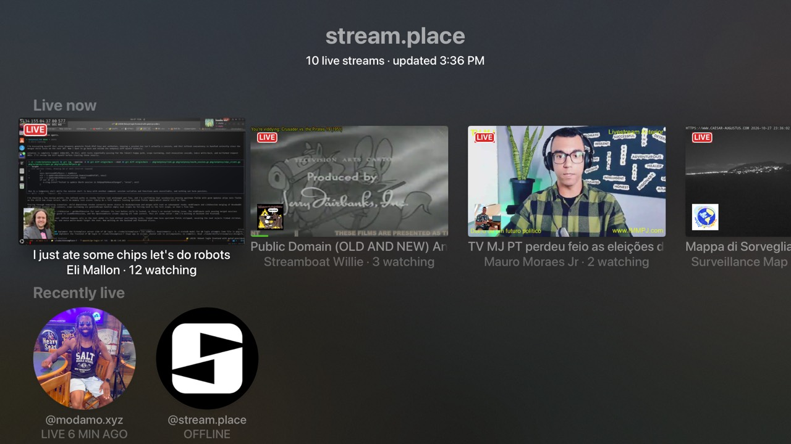

# streamplace

A [stream.place](https://stream.place) client: live streams from the AT Protocol, on Apple TV.



- **Home:** a "Live now" shelf (live thumbnail, LIVE badge, streamer avatar, title, viewers), refreshed every 30 s while the screen is visible and the app is in the foreground. Below it, "Recently live" streamers remembered in `localStorage`. When nobody is live, that shelf becomes "Streamers you might like". Loading and error templates are handled, and a failed refresh keeps the last list.
- **Stream page:** title, streamer, activity, tags, uptime and live viewer count, plus a shelf of chat (`<reviewCard>`s) that starts with the last 15 minutes and updates in real time over a WebSocket. Offline streamers get a profile page with "Check Again".
- **Watching:** plays the live HLS (CMAF) playlist with `usePlayer`, keeps the screen awake with `useKeepAwake`, and draws the live chat **over the video** with `<PlayerOverlay>`.

```sh
pnpm install && pnpm build   # from the repo root
cd examples/streamplace
pnpm dev                     # serves http://0.0.0.0:9101/
xcrun simctl launch booted dev.tvml-react.examples -TVMLServerURL http://localhost:9101/
```

The tvOS app is the shared [shell](../shell).

## Endpoints

| What | Where |
| --- | --- |
| Live streams | `stream.place/xrpc/place.stream.live.getLiveUsers` |
| One stream / viewers | `stream.place/api/livestream/{did}`, `/api/view-count/{did}` (404 = offline) |
| Thumbnail | `stream.place/api/playback/{did}/stream.jpg` |
| HLS | `stream.place/xrpc/place.stream.playback.getLivePlaylist?streamer={did}` |
| Avatars, bios, chatters' handles | `public.api.bsky.app/xrpc/app.bsky.actor.getProfiles` |
| Chat (WebSocket) | `wss://jetstream2.us-east.bsky.network/subscribe?wantedCollections=place.stream.chat.message&cursor=…` |

## Chat

Chat messages (`place.stream.chat.message`) are ordinary AT Protocol records
in each chatter's repo, with a `streamer` field. Bluesky's
[Jetstream](https://github.com/bluesky-social/jetstream) streams every new
one on the network as JSON, and replays history from a `cursor` (a time in
microseconds). `chat.ts` uses tvml-react's `WebSocket` (installed by
`TVMLReact.launch`):

- `useStreamChat(did, enabled)` opens one socket per stream page while the
  stream is live, including while the player covers the page, so the page's
  shelf and the overlay share it. It closes when you leave the page and when
  the app is suspended.
- A new socket replays the last 15 minutes; reopening (resume, a dropped
  connection, coming back to the page) continues from the last event it saw,
  so nothing in between is missed.
- It keeps messages whose `streamer` is this one and drops deleted ones. The
  newest 12 are kept, ordered by when Jetstream saw them; the overlay shows the
  newest 5.
- Chatters' handles come from the profile cache. Unknown authors are looked up
  in one batched `getProfiles` request, and a message shows up once its
  author is known.
- A dropped connection reconnects with backoff (1 s, 2 s, 4 s… up to 30 s).
  The shelf heading says when it's loading or reconnecting.

Jetstream filters by collection or by author, not by streamer, so the socket
carries every stream.place chat message plus Jetstream's account and identity
events (a few per second), and the app filters them. That chat isn't moderated
by stream.place, so hidden or banned messages can still show up.

## Data

Server state lives in [TanStack Query](https://tanstack.com/query) through
`tvml-react/query`. `main.tsx` puts `TVMLQueryProvider` in `launch`'s
`wrapper`, so the home screen and every pushed stream page share one cache.
That provider points TanStack Query's focus and online managers at TVJS: polling
pauses while the app is in the background and refetches stale data on resume,
and requests wait while the Apple TV is offline.

| Query | Key | Freshness |
| --- | --- | --- |
| Live streams | `["live"]` | `refetchInterval` 30 s, `staleTime` 10 s, sorted by viewers in `select` |
| One stream (+ viewer count) | `["stream", did]` | `refetchInterval` 15 s; starts from the live list's entry (`initialData`) |
| Chat | `["chat", did]` | never fetched: `useStreamChat` writes the messages and Jetstream cursor from its WebSocket, so a reopened page starts with them |
| Profiles | `["profiles", dids]`, `["profile", did]` | 10 min; the home screen waits for the live list so it's one request, and each batch seeds the single-profile cache (chatters' too) |

Screens use `useScreenQuery`, which pauses while a screen is covered: the home
screen stops polling while a stream page is pushed and refetches when it's
popped. Presenting the player covers the stream page too, so while
watching, the stream query passes `refreshWhileHidden: true` to keep the
overlay's viewer count updating. (Chat doesn't poll; its socket stays open.)

A failed refresh keeps the last data (TanStack's `isRefetchError`) and the
banner says so; no data yet and offline is a "You're offline" page
(`fetchStatus: "paused"`) that loads by itself on reconnect.

## Files

- `api.ts`: a `fetch` client. A 404 from `/api/livestream` means the streamer is offline; requests time out after 15 s and take TanStack Query's `AbortSignal`.
- `queries.ts`: the `QueryClient` and `queryOptions` for every query above.
- `chat.ts`: live chat over Jetstream (`useStreamChat`).
- `hooks.ts`: `useRecentlyLive` (the "recently live" history in `localStorage`, stamped on each successful live-list fetch) and `useNow` (a ticking clock for "5 min ago" labels).
- `StreamScreen.tsx`: the stream page and the chat overlay. The `<PlayerOverlay>` is mounted only while the player is up, because TVMLKit doesn't draw an overlay document assigned before the player is presented.
