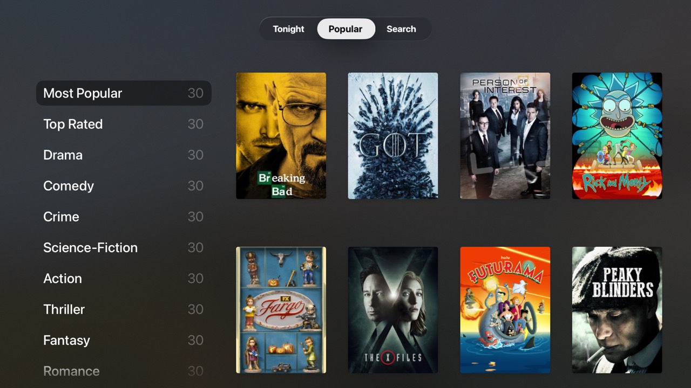

# TV Shows

A TV show catalog for tvml-react, built on the free [TVMaze API](https://www.tvmaze.com/api).



## What it shows

- **Native tab bar.** `menuBarTemplate` with three tabs (Tonight, Popular and
  Search). tvml-react doesn't support menu bars yet, so
  [`src/MenuBar.tsx`](src/MenuBar.tsx) prototypes support for them.
  Each `<MenuBarItem>` owns a TVML document and renders its children into it
  with `createPortal`. It attaches that document with the menu bar's
  `MenuBarDocument` feature when the item is selected. Tabs mount the first
  time they're shown and then stay mounted, so they keep their state.
- **Tonight.** `stackTemplate` shelves of today's US schedule, grouped by time
  slot and starting with "On Now". Your watchlist is shown at the top.
- **Popular.** A `catalogTemplate` with categories on the left (Most Popular,
  Top Rated, genres) and a `grid` of posters for each.
- **Search.** A `searchTemplate` with a debounced `onTextChange`. Before you
  type anything it shows a shelf of trending shows.
- **Show detail** (`productTemplate`). Shows the summary (select it to read the
  whole thing in a modal), genres and network in an `infoList`, a `ratingBadge`,
  a shelf of seasons and a cast shelf of `monogramLockup`s. A Watchlist button
  saves the show to `useLocalStorage`, and every tab and screen sees the change.
- **Three levels of `useNavigation().push`.** Show, then season (a
  `listTemplate` that previews the highlighted episode through
  `relatedContent`), then episode. "Next Episode" swaps the episode screen in
  place with `navigation.replace()`.
- **Data loading without `fetch`.** [`src/api.ts`](src/api.ts) wraps
  `XMLHttpRequest` with an in-memory cache. [`src/useApi.ts`](src/useApi.ts)
  switches between `loadingTemplate`, an error alert with Retry, and the
  loaded screen.

## Run it

```sh
pnpm dev   # serves http://localhost:9103/
```

Then launch the examples shell (`examples/shell`) pointed at it:

```sh
xcrun simctl launch <udid> dev.tvml-react.examples -TVMLServerURL http://localhost:9103/
```

`pnpm build` writes `dist/app.js` and `dist/Application.js`.

## Notes

- Elements inside a tab document only receive `onSelect` because
  `MenuBar.tsx` calls `createRoot(doc)` on each tab document. That root is
  never rendered into or unmounted. tvml-react only installs its event
  delegation on documents it presents itself; see the comment in the file.
- Screen hooks (`useIsScreenVisible`, `useScreenEvent`) inside a tab report on
  the menu bar's document, not on the tab's.
